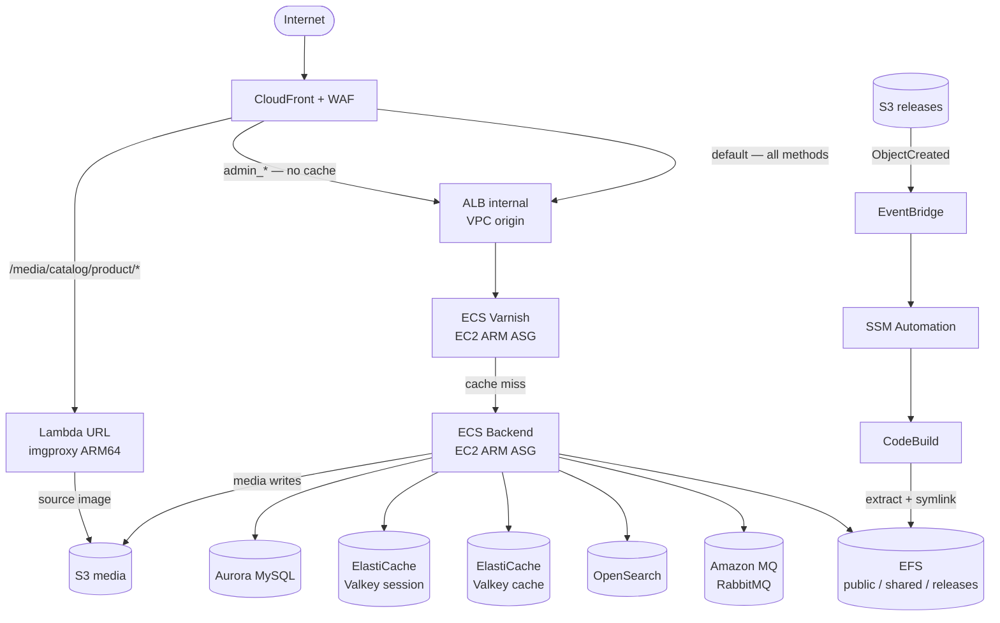

# Architecture Overview

This project deploys a production-ready Magento 2 infrastructure on AWS using ECS EC2 capacity providers backed by ARM Graviton instances. All compute tiers run inside a private VPC. CloudFront sits in front as the public entry point, handling CDN, TLS termination, WAF filtering, and image optimization routing.

---

## ASCII Architecture Diagram

```
Internet
    |
    v
+------------------+
|   CloudFront     |  WAF (IP allow/block, geo-block, rate-limit,
|   + WAF ACL      |  AWSManagedRulesCommonRuleSet)
+------------------+
    |            |
    |            +-----------------------------+
    v                                          v
 /media/catalog/product/*             All other requests
    |                                          |
    v                                          v
+------------------+               +----------------------+
|  Lambda URL      |               |  ALB (internal,      |
|  (imgproxy)      |               |  VPC origin via CF)  |
+------------------+               +----------------------+
    |                                          |
    v                                          v
+----------+                       +----------------------+
| S3 media |                       | ECS Varnish cluster  |
| bucket   |                       | (EC2 ARM, ASG)       |
+----------+                       +----------------------+
                                               |
                                               v
                                   +----------------------+
                                   | ECS Backend cluster  |
                                   | (EC2 ARM, ASG)       |
                                   +----------------------+
                                        |    |    |    |
                          +-------------+    |    |    +-----------+
                          |                  |    |                |
                          v                  v    v                v
                   +-----------+   +-------+  +--------+  +----------+
                   | Aurora    |   | Elasti|  | Open   |  | Amazon   |
                   | MySQL     |   | Cache |  | Search |  | MQ       |
                   | (RDS)     |   | Valkey|  | (ES)   |  |(RabbitMQ)|
                   +-----------+   +-------+  +--------+  +----------+

                   Side connections from Backend containers:
                   +-----+    +--------+    +----------+
                   | EFS |    | S3     |    | SSM Param|
                   |(EFS)|    | media/ |    | Store    |
                   |     |    | backup |    |          |
                   +-----+    +--------+    +----------+
```

---

## Traffic Flow

### Standard Request

1. A browser requests `https://mystore.com/catalog/category/shoes`.
2. CloudFront receives the request. The WAF ACL evaluates it against IP blocklists, geo-restrictions, rate limits, and AWS managed rules. Blocked requests are rejected here.
3. CloudFront's default cache behavior targets the ALB VPC origin. The request is forwarded to the internal ALB with a `X-Cloudfront-Secret` header.
4. The ALB HTTPS listener (port 443) checks for the matching host header and secret header. Requests lacking the secret header receive a fixed 418 response — direct ALB access without going through CloudFront is blocked this way.
5. The ALB forwards the request to the Varnish ECS target group.
6. Varnish checks its cache. On a hit, the response is returned immediately. On a miss, Varnish forwards the request to the backend service via CloudMap service discovery (`backend.<brand>.internal`).
7. The PHP-FPM backend container processes the request, reads catalog data from Aurora and search results from OpenSearch, reads session and cache data from ElastiCache Valkey, and serves the response.
8. Static files and media are served either from EFS (via `/public/current`) or proxied from S3.

### Admin Panel Request

The `admin_*` path pattern in CloudFront's ordered cache behaviors routes admin requests to the ALB VPC origin with caching disabled (`4135ea2d` — CachingDisabled policy). All HTTP methods are forwarded, ensuring POST/PUT/DELETE requests work correctly for admin operations.

---

## Image Optimization Flow

1. CloudFront receives a request matching `/media/catalog/product/*`.
2. The ordered cache behavior for this path pattern routes the request to the `lambda_imgproxy` origin instead of the ALB.
3. The Lambda function URL points to an imgproxy container image running in Lambda (ARM64, 2 GB memory). CloudFront signs the request with SigV4 via the Origin Access Control.
4. imgproxy reads query parameters (`rs`, `fit`, `wm`, `soea` are the allowed processing options), fetches the source image from the S3 media bucket (`s3://` source is enabled), applies the requested transformations, and returns the result.
5. imgproxy automatically negotiates WebP or AVIF based on the `Accept` header (`auto_webp: true`, `auto_avif: true`). Quality defaults: JPEG 70%, WebP 60%, AVIF 40%.
6. CloudFront caches the transformed image. The `ttl` is set to 31536000 seconds (1 year). ETag-based validation is enabled.

---

## Release Deployment Flow

1. A CI/CD system (e.g. GitHub Actions) packages the Magento application as a `.tar.gz` archive and uploads it to the `<project>-releases` S3 bucket.
2. The S3 bucket has EventBridge notifications enabled. S3 emits an `Object Created` event to the default EventBridge bus.
3. An EventBridge rule matches events with source `aws.s3`, detail-type `Object Created`, bucket matching the releases bucket, and object key ending in `.gz`.
4. The rule target is an SSM Automation document (`<project>-LatestReleaseDeployment`). EventBridge passes the S3 object key as a parameter.
5. The SSM document starts a CodeBuild build (`<project>-deploy-release`), passing the object key as the `RELEASE_FILE` environment variable. It then sends an SNS notification to the `devops` topic.
6. CodeBuild runs inside the VPC (private subnets) and mounts EFS at `/mnt/efs`. The buildspec performs:
   - Download release archive from S3 to `/tmp/release.tar.gz`
   - Extract to `/mnt/efs/releases/<release-name>/`
   - Link `/mnt/efs/shared/media` → `<release>/pub/media`
   - Link `/mnt/efs/shared/var` → `<release>/var`
   - Atomic symlink: `/mnt/efs/public/current` → `<release>`
   - Remove all but the three most recent releases from `/mnt/efs/releases/`
7. ECS backend containers have EFS mounted at `/home/<brand>/public` (read-only) and `/home/<brand>/shared` (read-write). The container `workingDirectory` is `/home/<brand>/public/current`, which resolves through the symlink to the new release. No container restart is required — the running containers see the new code immediately via the updated symlink.

---

## Data Layer

| Service | What it stores |
|---------|---------------|
| Aurora MySQL 8.0 | Magento catalog, orders, customers, configuration, sessions (optional) |
| ElastiCache Valkey `session` cluster | PHP session data |
| ElastiCache Valkey `cache` cluster | Magento full-page cache backend, block cache, configuration cache |
| OpenSearch | Magento catalog search index (products, categories, attributes) |
| Amazon MQ (RabbitMQ) | Async message queues: order processing, inventory updates, indexer queues |
| EFS `public/` | Live release files (read-only to backend containers) |
| EFS `shared/` | `pub/media/` and `var/` — persistent across deployments, writable |
| EFS `releases/` | Up to three release archives extracted on disk |
| S3 `media` | Product images, customer uploads, processed media |
| S3 `releases` | Release tar.gz archives (versioned, EventBridge enabled) |
| S3 `backup` | Database dumps and other backup artifacts |
| S3 `logs` | ALB access logs, CloudFront access logs |
| SSM Parameter Store | All service credentials and endpoints (passwords as SecureString) |

---

## NAT Strategy

Private subnets route outbound internet traffic through a lightweight EC2 `t4g.nano` instance (Debian 13 ARM64, Graviton2) rather than a managed NAT Gateway.

The NAT instance runs `iptables MASQUERADE` and `ip_forward=1`. It is provisioned by the inline VPC module. With `nat_gateway.single: true`, a single NAT instance serves all private subnets; with `single: false`, one instance is launched per availability zone for redundancy.

Cost comparison (us-east-1):
- Managed NAT Gateway: ~$32/month per AZ + $0.045/GB data processing
- t4g.nano NAT instance: ~$0.50/month + no per-GB charge on EC2 traffic

The trade-off is that EC2 NAT instances require patching and may briefly lose connectivity during instance replacement. For most Magento workloads this is acceptable. For strict availability requirements, switch to a NAT Gateway by removing the EC2 NAT instance and adding an `aws_nat_gateway` resource in the VPC module.

---

## Security Model

- **No public EC2 SSH.** All EC2 instances and ECS tasks are in private subnets. Shell access is via AWS Systems Manager Session Manager (SSM Agent is installed via the `AmazonSSMManagedInstanceCore` IAM policy on the ASG instances).
- **All secrets in SSM Parameter Store.** Passwords (Aurora, RabbitMQ) are stored as `SecureString`. Non-sensitive connection strings are `String`. ECS task definitions reference SSM parameter ARNs directly — secrets are never baked into container images or environment variable plaintext in the task definition.
- **ALB is internal.** The ALB has `internal = true` and is only accessible from within the VPC. CloudFront reaches it via a VPC origin. The `X-Cloudfront-Secret` header (a random UUID generated at apply time) is required by the ALB listener rule, preventing direct access.
- **WAF on CloudFront.** The WAF ACL includes:
  - IP allowlist (explicit allow, priority 0)
  - IP blocklist (explicit block, priority 1)
  - Geo-blocking (configurable countries, priority 2) — defaults block CN, RU, IR, KP, SD, SY, CU
  - Rate limiting: 500 requests per IP per 120 seconds (priority 3)
  - AWSManagedRulesCommonRuleSet (priority 4)
  - AWSManagedRulesAmazonIpReputationList (priority 5)
- **Read-only root filesystem.** ECS container definitions set `readonly_root_filesystem = true`. Varnish uses a `tmpfs` mount for its working directory.
- **IMDSv2 required.** The ASG launch template sets `http_tokens = required`, enforcing IMDSv2 on all EC2 instances.
- **Encrypted storage.** EFS is encrypted at rest. All EBS volumes in the ASG use `encrypted = true`. ElastiCache clusters have `transit_encryption_enabled` and `at_rest_encryption_enabled`.

---

## Mermaid Diagram


